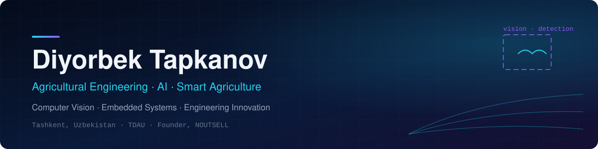

  

  
  
  

---

### About Me

I'm an agricultural engineering student at **Tashkent State Agrarian University (TDAU)**, studying the application of innovative machinery and technologies in agriculture. My work sits where engineering meets software: using **AI and computer vision** to solve real problems in the field, and building the hardware and systems that make it work outside the lab.

- Agricultural Engineering student — innovative machinery & technologies in agriculture
- AI & smart agriculture — field-tested bird detection and deterrence
- **Founder & Managing Director, NOUTSELL MChJ** (est. June 2026)
- Hands-on with computer hardware, networks and 3D printing

### Focus Areas

- **AI & Computer Vision** — detection systems for agricultural use
- **Smart Agriculture** — automation for real field conditions
- **Embedded Systems** — ESP32-based and solar-powered autonomous devices
- **Software Development** — full-stack web platforms in TypeScript
- **IT Infrastructure** — hardware, LAN/Wi-Fi, basic network configuration
- **3D Printing & Prototyping** — FDM printing for rapid prototypes

### Featured Projects

<table>
<tr>
<td width="50%" valign="top">

#### AervionX 360
`Engineering project` · `Field-tested`

An AI-assisted bird detection system with **laser-based deterrence**, running autonomously on a **solar panel and battery** power supply. Built and tested in real field conditions.

Source code and technical details are not public.

</td>
<td width="50%" valign="top">

#### TDAU Research Activity Platform
`Private` · `In development`

A full-stack web platform for managing a university's research activity: doctoral programs, research outputs, projects and grants, events, and an open public portal — with role-based access for six user roles.

**Stack:** TypeScript · NestJS · Node.js · PostgreSQL · TypeORM · Next.js · React · Tailwind CSS

Private repository.

</td>
</tr>
</table>

### Tech Stack

**Software** — used in my projects

  

**IT & Hardware** — practical experience

- Windows 10 / 11 · PC assembly and hardware troubleshooting · printer and MFP maintenance
- LAN and Wi-Fi installation · router and switch configuration (basic) · IPv4, DHCP, DNS
- Cat5e / Cat6 Ethernet cabling · RJ45 T568B termination

**3D Printing & Prototyping**

- Creality Ender-3 V3 KE · FDM printing with PLA and PETG
- Creality Print · Cura · PrusaSlicer

**Currently exploring:** computer vision for bird detection · ESP32-based embedded systems · solar-powered autonomous devices

### Education & Achievements

| Institution / Award | Details |
|---|---|
| **Tashkent State Agrarian University (TDAU)** | Agricultural Engineering — innovative machinery & technologies in agriculture |
| **Beruniy State Scholarship** | 2025–2026 |
| **Mirzo Ulug‘bek Vorislari** | National-stage winner, 2024–2025 |

### Let's Connect

Open to collaboration on smart agriculture, AI and engineering projects, and to academic and research opportunities.

  
  

